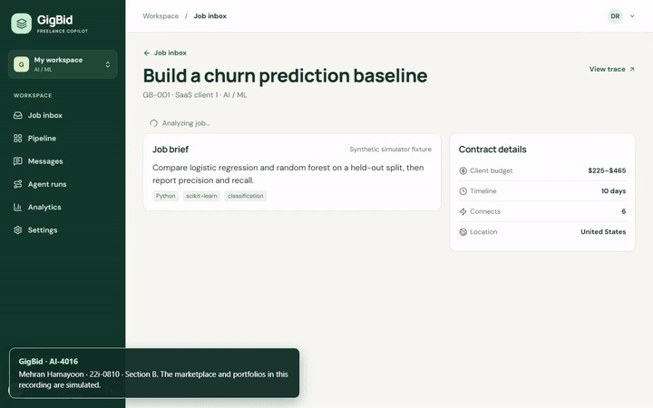
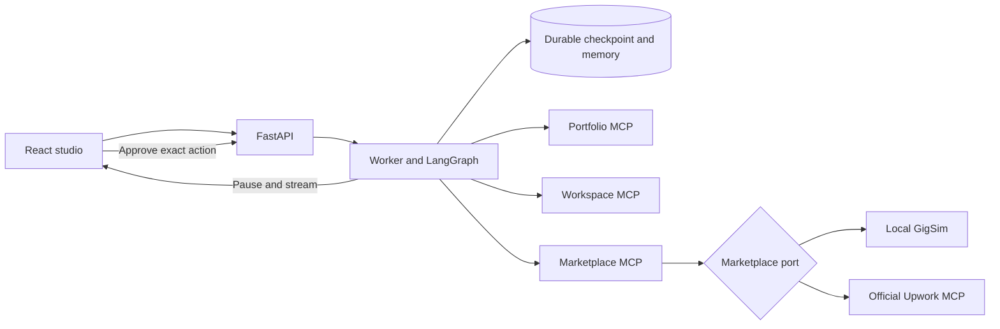

# GigBid

GigBid evaluates freelance opportunities, explains fit and risk, and drafts proposals from cited portfolio evidence. The React studio shows the exact draft and its Connects cost before human approval. A second LangGraph handles simulated client replies and interview availability.

[Setup and deployment](docs/RUNBOOK.md) · [Portfolio MCP install](mcp_servers/portfolio/README.md) · [Engineering field notes](docs/TECHNICAL_WRITEUP.md) · [Reproducible results](evals/results/summary.json)

## Review the workflow

Start locally with `make dev` after running `python infra/prepare_env.py`. Alternatively, install Python and Node dependencies and follow the single-service instructions in the runbook. Choose **Explore simulator demo**. Analyze **GB-001** and open the studio. Inspect a citation, check the Connects preview, approve, then open Messages to draft and approve the reply. Analyze **GB-003** and **GB-004** to see the unpaid-work and planted-instruction checks.

## Architecture

[Bid graph](docs/images/bid.mmd) · [Conversation graph](docs/images/conversation.mmd) · [Approval and Critic revision trace](evals/results/trace-gb-001.json) · [Scam trace](evals/results/trace-gb-003.json) · [Injection trace](evals/results/trace-gb-004.json)

## Local development results

| Retrieval | Recall@5 | MRR | nDCG@10 |
|---|---:|---:|---:|
| V0 cosine baseline | 67.5% | 1.000 | 0.777 |
| V2 BM25 + cosine, shipped | 96.7% | 1.000 | 0.916 |
| V8 corrective | 97.5% | 1.000 | 0.918 |

| Decision arm | Accuracy on 50 local fixtures | Persistence and approval |
|---|---:|---|
| Direct rule | 60% | Classification proxy |
| Staged rule | 100% | Classification proxy |
| Hand-built LangGraph | 100% | Checkpoints, interrupts, simulator writes |

Adding a verified skill-tag citation changed the paired local simulator result from zero replies out of 24 excerpt-only proposals to 24 replies out of 24. The fixture explicitly rewards exact skill mentions. V2 shipped for its recall and lower overhead than corrective retrieval. These results describe the student-built simulator. See the [data card](docs/DATA_CARD.md) for provenance and limitations.

## Engineering

`make test` runs Python tests including in-memory MCP contracts, resume and idempotency. `make eval` regenerates the research artifacts. Run `npm --prefix apps/web run test:e2e` after building the web client and installing Chromium with Playwright. The typed client is generated by `make schema`. See [runbook](docs/RUNBOOK.md) and [AI usage disclosure](docs/AI_USAGE.md).

**Résumé**  
Built a LangGraph and MCP freelance copilot with resumable approval and idempotent simulator writes.  
Measured 96.7% hybrid evidence Recall@5 over 60 synthetic development jobs.
