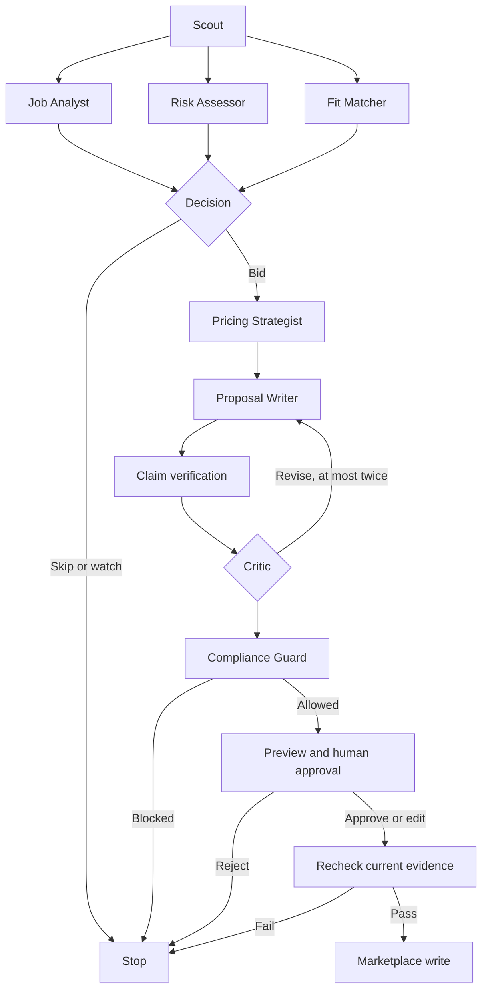
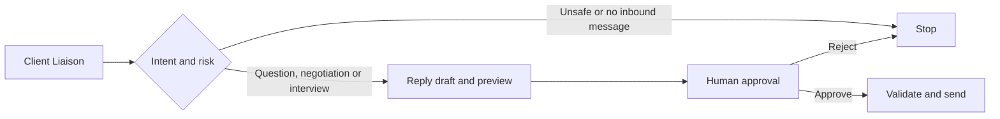

# Architecture

The FastAPI layer authenticates the tenant, queues a durable run and streams redacted node events. The React client never calls the marketplace directly. Internal MCP tools call a single marketplace port. The simulator handles Connects and proposals in one transaction per external action.

## Bid graph

## Conversation graph

The graphs are hand-written StateGraphs. The bid branches use LangGraph Send and a join. Typed results allow routing by explicit fields. Checkpoints store current graph state and the pending interrupt. A separate event ledger stores trace summaries. A LangGraph Store holds tenant-scoped style and outcome namespaces. An outcome enters memory after an approved write returns replied, interview, or hired. Three consistent shorter approved edits can promote the concise style rule. SQLite supports the single-host path. Compose selects the Postgres checkpointer/store and a Redis-backed Arq worker.
